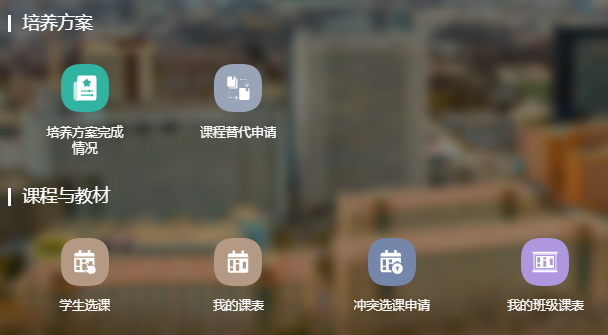
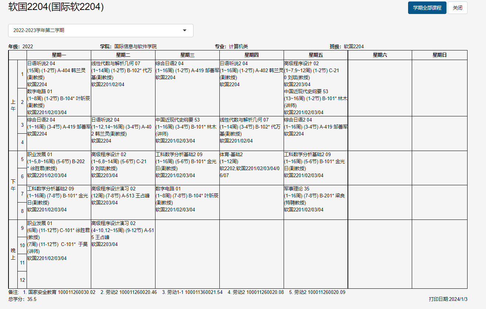
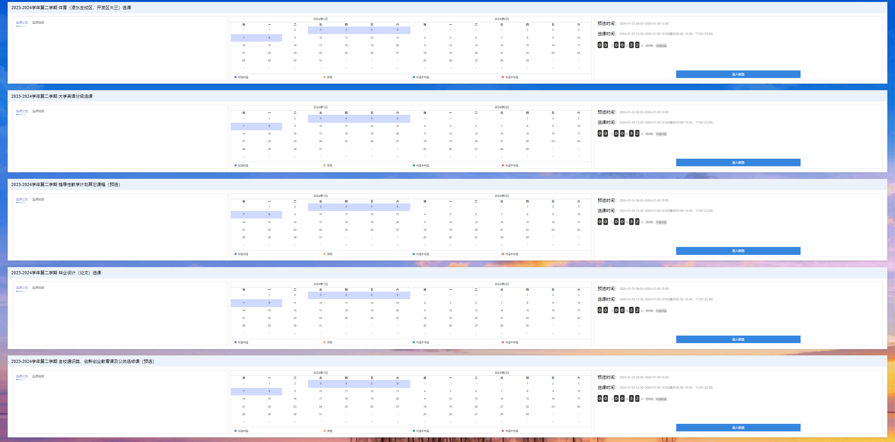
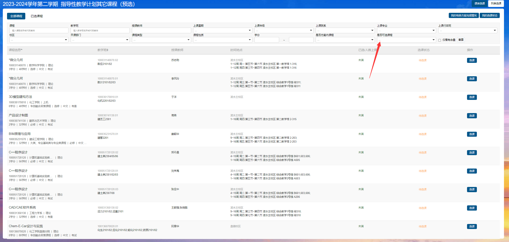

import { Aside } from "@astrojs/starlight/components";

特别鸣谢：[AzeniaX](https://github.com/AzeniaX)

## 如何进入选课系统

大连理工大学学生综合教学管理系统：[http://jxgl.dlut.edu.cn/student/home](http://jxgl.dlut.edu.cn/student/home)

登录系统后下拉，这些是我们选课阶段会用到的：

点击 **学生选课**，即可进入选课系统。

## 班级课表

首先，我们要认识班级课表，在教务系统找到”我的班级课表”，点击进入即可看到以行政班为单位安排的班级课表。

> **提示**：日常向他人介绍自己所在班级时，通常使用**行政班**；专业班主要用于选课系统标识，在绝大多数场景下无需提及。

这张课表是教务预先安排好的，包含了全部的本学期建议修读的必修课，并且已经分配好了教学班和老师。因此，对于必修课程，我们只需要对照班级课表上面的课程依次选择即可。

## 选课系统操作

点开选课系统，我们可以看到有很多项，它们分别对应了不同的课程。

- **凌水校区和开发区校区大三的体育选课**，大一大二可以无视。
- **大学英语分级选课**，根据你入学英语考试的分级情况进行后续的大英选课。
- **指导性教学计划其它课程（预选）**，我们的必修课在这里选择。
- **毕业设计(论文)选课**，大一大二可以无视。
- **全校通识类、创新创业教育课及公共选修课**，我们的通识课和选修课在这里选择。

点击其中一项进入之后，会看到这样的界面。上面的各项索引请妥善使用，能帮助你更快找到课程。

如果看不到课程，记得检查”是否可选课程”这一项，将其改为可选即可。使用列表选课选择结束后，可以点击右上角的课表选课，检查自己所选课程的排列情况。

部分课程在选课系统中按”组”划分教学班。”默认组”包含该课程全部可选教学班，是全集；”1组””2组”等为按特定规则划分的子集。学生无法直接选择”默认组”，只能从具体分组（如1组、2组）中选择一个。

注意：在哪一项里面选择的课程就要在哪一项里面取消。如果无法退课，查看自己这门课是不是在这个项目里面选择的。例如，在指导性教学计划其它课程里面选择的课程，在其他选课项目里面是无法退课的，此时只需要回到指导性教学计划那一项里面就可以正常退课了。

## 选课阶段

### 选课预览

在每年选课期的最初一到两天，选课系统提前开放。此时可以提前预览本学期开设的课程。

### 预选

在选课期的最初一周左右时间是预选阶段。在该阶段内，所有课程不限人数，选课不分时间先后，不含重修复修选课。因此不需要着急，在预选的几天内合理安排时间选课即可。

预选阶段进行的是必修和公共选修课的选择。开发区校区的体育课在正选阶段进行抢课，预选阶段的体育课只是随机分配的占坑课程，在预选阶段结束后自动退掉，无需在意。

> **注意**：预选阶段结束后、正选阶段开始前，选课系统可能会出现课程"回滚"现象（已选课程短暂消失又恢复）。这是系统在后台进行抽签处理时的正常显示状态，不必惊慌。最终选课结果以正选阶段开始时系统显示的为准，如仍有疑问请截图保存并咨询教务老师。

#### 意愿值

在预选阶段，每个人会被分配到 **100意愿值**。预选结束后会启动抽签机制：你选这门课用n个意愿值，相当于在这门课的桶里投了n+1个签，系统会对所有签进行随机遍历。如果某个签对应的同学没选上这门课，则将其加入成功选课列表；如果该同学已选上课，则继续进行下一轮遍历，直到成功选课列表的size与总人数相等。

也就是说，用的意愿值越多，选上课的概率越大，但即使给100个意愿值，概率也不会等于100%；用的意愿值越少，选上课的概率越小，但即使给0个意愿值，概率也不会等于0%。另外，如果课程没被选满，那么给0个意愿值也能选上课。

班级课表里面的必修课，意愿值分配 **0** 即可，基本不可能选不上，因为课容量都是超额的，如果实在担心掉课，可以分配 **1-5 意愿值**意思一下。意愿值主要用在选修课和劳动课等的抽选。

由于开发区校区劳动2课程容量极其有限，美育课一般只有音乐鉴赏一个选项，因此抢这门课程很多时候100意愿值也难选上。请珍惜你选上的选修课和意愿值。

预选的课程情况并不是最终的选课结果，务必在正选阶段核实自己的选课结果。

### 正选

在预选阶段结束后将会开启正选阶段。正选阶段**一般于次日中午12:30开始**，可以查看自己预选阶段后成功选上和未被抽上的课程，并确认自己的选课情况。正选阶段正式开始前系统处于关闭状态，无法进入选课界面。

除此之外，在本阶段有课余量的课程可以继续选择。正选阶段所有课程限定容量，按照先选先得的原则进行。为避免课程买卖等行为，学校系统会将退课等释放的课程容量于每天中午12:00定时释放。

> **注意**：部分课程（如课程设计类）可能在正选当天才会出现在选课系统中，预选阶段看不到属于正常情况，无需焦虑。

> **注意**：选课期间，每天 **15:30–16:30**，教学运行保障中心将对选课数据进行处理，此期间选课工作暂停。请勿在此时间段内进行选课操作。

### 补退选

在新学期开学前的一周到教学周的前两周是补退选阶段。在该时间段内可以进行重修/复修选课、国内外交流等学籍异动学生选课及本研衔接选修课程选课、本科生选研究生课程。在补退选阶段，因为转专业、重修等原因导致课程冲突的学生可以进行冲突选课申请。除此之外，如果不想上的课程也可以在此阶段随时退课。在此阶段，部分课程视情况会增加一定课容量，可根据自己的实际情况进行补退选。

## 必修课

对于必修课，通常直接按照班级课表选课，并且意愿值给 **0** 即可。如果认为班级课表里分配的老师可能有争议，且所在学院允许跨教学班选课，可以选择同时间的另一个教学班老师的同名课程，并分配一定的意愿值。

如果你的课程不能在预选阶段跨教学班选课，那么预选可以不用选他，等正选的时候直接选其他老师的课。因为要避免时间冲突，如果预选选上了，正选的时候要先退课才能选，会慢人一步。

## 通识/选修课

多数学院本科生培养方案规定需要修读：

- 全校通识课
- 劳动2课程
- 《国家安全教育》课程
- 创新创业课程
- “四史类”课程
- “美育类”课程
- 《经济学原理》及《现代工程导论》两门课中选修一门

这些课程在毕业之前需要修读完毕。开发区校区除国家安全教育作为网络通识课之外，其他几类课程的开课容量和时间都比较有限。因此建议从大一开始就选择这些课程，以免后期选不上或者必修课时间覆盖掉这些课程。

关于 **四史类** 课程，据同学反馈该课程**期期撞课**（与必修课冲突概率高），选课前务必留意培养方案中对该课程的学期要求，提前做好规划。

如果因时间冲突实在选不上，可以私聊教务老师帮忙协调。教务老师工作日工作时间内在QQ上会回复，通常几小时内可收到回复，也可以直接前往教务办公室当面沟通。

关于 **美育类** 课程，常见选项包括**音乐鉴赏**。《数据时代的艺术表达》属于**综合素质类**课程，不在美育类模块内。该课程无统一期末考试，考勤为老师随机点名（通过发纸写题目的方式进行），且结课有大作业（如手绘邮票设计，用纸笔手绘完成，非电脑作图）。

24级通识课要求为：经济学/现代工程导论 + 美育课 + 任意一门其他通识课（即三门即可满足要求），并非所有类别都要修读。建议根据本人培养方案确认具体要求后再选课。

《经济学原理》在开发区校区部分学期可能不开放选课，主校区和盘锦校区通常可选。若培养方案要求在《经济学原理》和《现代工程导论》中二选一，选课前请先确认本校区是否有开课。

## 必修课时间冲突

如果你在选课时发现两门课程都像是“必修”，但系统提示存在时间冲突，不要急着盲选，先做这三步：

1. 回到培养计划里确认两门课是否都属于当前学期必须完成的课程。
2. 在选课系统里查看课程名称后的开课时间，判断这门课是不是后续学期还会继续开设。
3. 再结合班级课表确认冲突是不是教务排课导致的同一时段冲突。

一般来说，如果其中一门课在后续多个学期还会继续开，而另一门课只在某个固定学期开放，那么优先保留开课窗口更窄的那门课。以软件学院（软国）为例，1-5班小学期课程与“改开史”（改革史）冲突，6-10班与“创新”冲突。两种情况下判断依据一致：程序课只在大一小学期开设，改开史/创新课程后续学期还会继续开，因此优先保留程序课，另一门放到后续学期补修更稳妥。

如果两门课都不确定是否能后续补选，或者都显示为当前培养计划中的关键课程，建议尽快咨询辅导员、教学秘书或对应课程老师，不要仅凭意愿值和抢课结果硬赌。

部分同学反映创业、四史与小学期必修实践课存在冲突。可参考往届经验，在同一时间段的实践课中选择其他教学班来避开冲突。

## 选课结果查询

选课结果（尤其是预选抽签结果）可以通过以下方式查询：

- **i大工APP** → 大工教务 → 我的课表
- 或直接登录 [教务系统网页端](http://jxgl.dlut.edu.cn/student/home) 查看个人课表

预选结束后的抽签筛选需要一定时间处理，结果并非预选一结束就立即公布。原有经验中既有当天下午可查询的情况，也有建议次日再查询的情况；具体公布时间请关注教务老师或学院 QQ 群的通知。可在综合教学管理系统“我的课表 → 全部课程”查看选中情况，并在正选阶段再次核实。未选上的课程可留意正选阶段每天中午 12:00 释放的退课名额。

## 选课时间安排（2026 年小学期）

<Aside type="caution">
  以下日期为2026年具体排期，请以教务系统最新通知为准。
</Aside>

| 阶段 | 时间 |
|------|------|
| 正选 | 6月18日12:30 — 6月24日17:00 |
| 补退选 | 6月29日12:30 — 7月3日17:00 |

## 免听申请

<Aside>
  一般只有转专业和重修的同学才会审核通过。如果是第一次选课，请提前和授课老师和教务老师沟通清楚。
</Aside>

在补退选阶段进入冲突选课申请模块，选择要申请的课程，填写申请理由，提交申请。等待审核通过后，即可免听该门课程。

申请免听前请先和授课老师联系，确定好后再进行申请。以免老师忘记审核或者被拒绝。一学期最多可以申请4次免听，被拒绝的申请也计算在内。

一般来说免听的同学没有平时分，期末考试卷面成绩计算即为终成绩。但是也有部分课程，如微积分等，做了作业也会给一定的平时分。具体情况请和授课老师沟通，可以向对应班上的同学索要课程群，以免漏掉信息。

## 注意事项

1. **《国家安全教育》课程**建议直接在课比较少、时间充裕的大一下学期选课。它作为网络通识课容量无限且不占据正课时间，下个学期考试前将网络平台上的视频看完并按时在电脑上参加考试即可。
2. **非必修课**选完后如果忘了去上，需要白交学费，成绩单上会留下0分记录，但据同学反馈一般不会影响保研等其他事项。不过仍建议尽量避免这种情况。
3. 软国有意向参加“2+2”赴日学习的同学，在赴日前必须完成“国家安全教育”课程的修读。
4. 网络通识课均为通识类扩展课程，有“尔雅通识教育网络课”（课程代码以“y”结尾）和“东西部联盟通识教育网络课”（课程代码以“z”结尾）。该类课程均为网络授课，不安排具体时间地点。请选择此类课程的同学认真检查选课结果，并在规定的学习平台进行注册、学习及考核。
5. **小学期课程实际情况**：据同学反馈，大二小学期多数课程出勤要求较严，基本不存在能提前离校的课，大部分老师每节课都会点名。选课前不宜抱侥幸心理。此外，选课系统中填写的老师不一定是实际上课的老师，以实际情况为准。
6. **创新创业课程**：两门创新创业课程均需修读。签到通常以问卷二维码形式进行。部分班级最终以小组大作业形式评定成绩。
7. **四史课程**：中共党史（2026年数据）也为机考开卷形式，占比50%，可带教材和打印材料，题型较固定，建议找老师要复习PPT直接背诵。
8. **跨学院选课学分认定**：选课时如果选择了其他学院开设的课程（教学班不属于自己所在学院），学分认定存在不确定性。如需跨学院选课，建议提前咨询本学院教务老师确认学分是否可认定。
9. **0学分课程**（如部分“专创融合”课程）：此类课程不纳入毕业学分统计，不影响最终成绩，也不需要额外缴纳学分制学费。成绩单上可能会显示0分，但据同学反馈不会拉低平均分，无需补考或重修。
